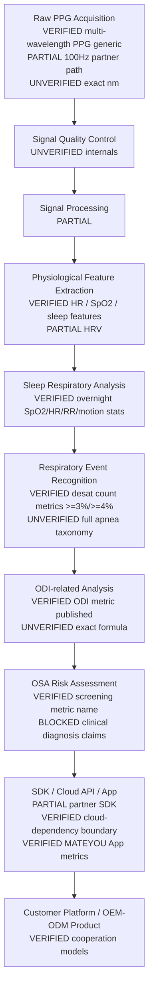

# OSA End-to-End Technical Architecture — WP07-B

Generated (UTC): 2026-11-11T14:15:00Z · Local: 2026-11-11 22:15 Asia/Shanghai

**Rule:** Diagram stages are conceptual. Status tags show what is evidenced in-repo vs restricted/cloud-dependent vs unconfirmed.

## Mermaid

## Stage cards

| Stage | Input | Processing | Output | HW dep | Algo dep | SDK/Cloud | Validation | Missing evidence |
|---|---|---|---|---|---|---|---|---|
| Raw PPG | Optical PPG + IMU/temp | Sensing | Raw/processed streams | Ring1C reference; others UNVERIFIED | — | Partner SDK PARTIAL; 100Hz PARTIAL | Engineering unpublished | nm, formats, per-SKU |
| Signal QC | Raw streams | Quality gates | Usable windows | Same | Undocumented | Likely device/cloud mix | UNVERIFIED | QC SOP |
| Signal processing | Usable windows | Filtering/features | Waveform features | Same | Undocumented | Mix | PARTIAL | Design notes |
| Feature extraction | Processed signals | Metrics | HR, SpO2, sleep features | Same | Product algorithms | Often cloud for rich metrics | VERIFIED metric names | Depth docs |
| Sleep respiratory | Overnight features | Aggregation | SpO2 drops, RR, HR, motion | Same | OSA module | Cloud likely | VERIFIED published | Failure modes |
| Event recognition | Overnight SpO2/etc. | Event counting | >=3%/>=4% drop counts | Same | Undocumented | Cloud likely | PARTIAL | Taxonomy |
| ODI | Desat events | Index calc | ODI / ODI score | Same | Undocumented | Cloud likely | Metric VERIFIED; formula UNVERIFIED | Definition |
| OSA risk | ODI/AHI/related | Risk/screening label | OSA screening + AI suggestions | Same | Undocumented | Cloud likely | Metric VERIFIED; clinical BLOCKED | Validation |
| Integration | Streams/metrics | API/App | Partner App / MATEYOU App | Same | License split | SDK+Cloud PARTIAL | Commercial framing VERIFIED | API catalog |
| OEM/ODM | Requirements | Eng+mfg | Custom product | Platform choice | Project scope | Same | Models VERIFIED | Cases |

## Availability classes
1. **Available and implemented (public metrics):** SpO2/HR/sleep/OSA module metric names on Ring1C/MATEYOU stack.
2. **Available with restrictions:** Partner SDK / 100Hz / customer App — project-scoped.
3. **Cloud-dependent:** Many health metrics / algorithm services — must disclose.
4. **Under development / research:** Anything not in published metric list — do not claim.
5. **Not confirmed:** Exact wavelengths, ODI/AHI internals, clinical validation, Ring1 medical functions.
